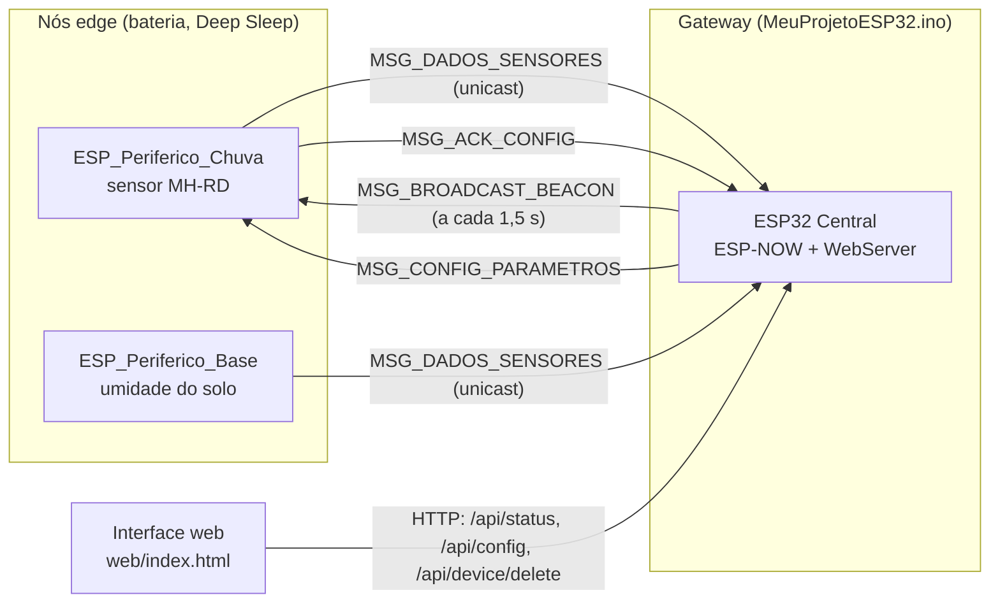
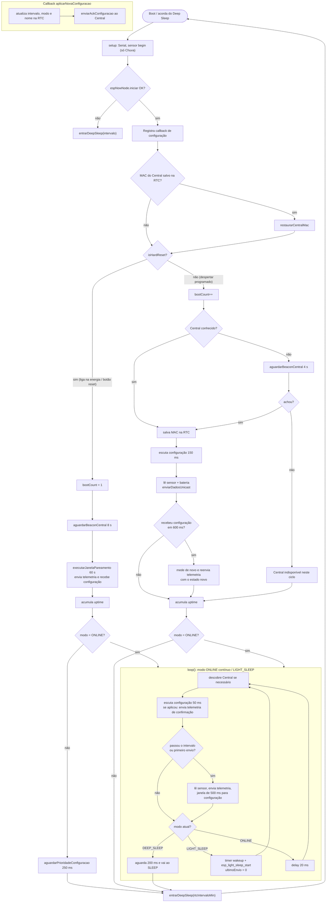
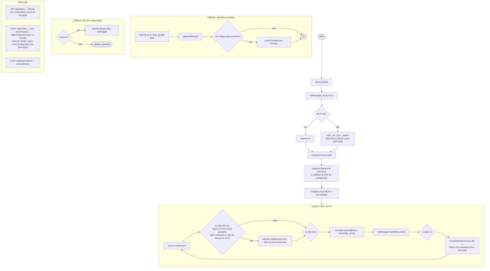

# MeuProjetoESP32 — Sítio Online

Monitoramento agrícola com ESP32 usando **ESP-NOW** (sem roteador entre os nós) e uma **API REST + interface web** no Central.

> **Fluxos interativos:** abra [`docs/index.html`](docs/index.html) (publicado em https://br-tavares.github.io/MeuProjetoESP32/) no navegador para ver os grafos de cada firmware (vis.js, funciona offline). Clique em um bloco para ver o que faz e a linha do código. Os diagramas Mermaid abaixo são a versão renderizada pelo GitHub.
>
> **Prova de conceito (branch `com-mini-pc`):** o plano de trabalho atual, com o que é núcleo e o que é supérfluo no firmware, está em [`docs/index-poc.html`](docs/index-poc.html). Os Mermaid abaixo ainda descrevem o Central da `main`, com servidor web.

### Abrindo e atualizando os fluxos

**Abrir (Windows):** dê duplo clique em [`docs/abrir-firmwares.bat`](docs/abrir-firmwares.bat). Ele sobe um servidor local (só PowerShell, sem instalar nada) e abre a página no navegador. Feche a janela do console para parar.

**Atualizar:** os grafos vêm de [`docs/data/firmwares.json`](docs/data/firmwares.json) (nós, arestas, texto de cada bloco). Edite o JSON e atualize o navegador (F5). Um grafo novo em `graphs` aparece sozinho na seção "Outros grafos".

**Abrir sem servidor:** navegadores bloqueiam `fetch()` de arquivos locais, então um duplo clique direto em `index.html` usa a cópia `docs/data/firmwares.js`. Para regenerá-la depois de editar o JSON, rode `node tools/gen_firmwares_js.mjs` (Node 18+), que também valida o JSON: ids repetidos, arestas para nós inexistentes, `kind` inválido. Com `--check` ele só confere se o `.js` está em dia. Quem usa o `.bat` não precisa disso.

## Visão geral dos firmwares

O repositório tem 4 sketches `.ino` principais, em dois papéis:

| Papel | Sketch | Energia | Comportamento |
| :--- | :--- | :--- | :--- |
| **Gateway / Central** | [`MeuProjetoESP32.ino`](MeuProjetoESP32.ino) | Sempre ligado (rádio ativo, servidor HTTP) | Recebe telemetria via ESP-NOW, serve a API REST, despacha configurações |
| **Nó edge (sensor de chuva)** | [`esps_perifericos/ESP_Periferico_Chuva/`](esps_perifericos/ESP_Periferico_Chuva/ESP_Periferico_Chuva.ino) | Bateria, Deep Sleep | Acorda, lê o sensor, envia, dorme |
| **Nó edge (template genérico)** | [`esps_perifericos/ESP_Periferico_Base/`](esps_perifericos/ESP_Periferico_Base/ESP_Periferico_Base.ino) | Bateria, Deep Sleep | Mesmo ciclo; lê umidade do solo (ADC) |
| Exemplo | [`exemplos/ESP_Central_EspNow/`](exemplos/ESP_Central_EspNow/ESP_Central_EspNow.ino) | — | Central mínimo, só ESP-NOW (sem HTTP) |

Os dois sketches edge têm o mesmo fluxo; só mudam a leitura do sensor e a função de bateria.

## Arquitetura

## Fluxograma: nó edge (`ESP_Periferico_Chuva.ino` e `ESP_Periferico_Base.ino`)

Estado persistente em memória RTC (sobrevive ao Deep Sleep): `bootCount`, `tempoUptimeAcumuladoSegundos`, `rtcIntervaloMin`, `rtcModoOperacao`, `rtcNodeName`, `rtcMacCentral`, `rtcCentralConhecido`.

Particularidades do `ESP_Periferico_Chuva`: antes de ler, o BJT NPN liga o sensor por 50 ms (média de 8 amostras ADC) e desliga em seguida, contra oxidação das trilhas. O `ESP_Periferico_Base` liga o sensor por um pino VCC (`PIN_SENSOR_VCC`, se definido), aguarda 30 ms, lê o ADC e desliga.

## Fluxograma: gateway (`MeuProjetoESP32.ino`)

## Observações sobre o estado atual do código

Pontos observados durante a leitura, úteis para a próxima etapa do projeto:

1. **O gateway não tem gestão de energia solar.** `MeuProjetoESP32.ino` roda sempre ligado (Wi-Fi/AP + WebServer + beacon a cada 1,5 s). Para operar com painel solar e bateria, faltam leitura de tensão da bateria/painel, política de sono ou de duty-cycle do rádio e persistência dos dados, o que ainda não existe no código.
2. **Janela de recepção só informativa.** `CICLO_RECEPCAO_MS` (60 s) e `DURACAO_JANELA_MS` (10 s) são usados só para exibir o cronograma em `/api/status`. O rádio do Central nunca é desligado fora da janela.
3. **Bateria simulada nos nós.** `lerBateria()` devolve valor fixo (3980 mV), então a porcentagem de bateria ainda não reflete leitura real de ADC. A temperatura também é constante (25,0 / 24,8).
4. **Código duplicado.** Os dois sketches edge (`Chuva` e `Base`) diferem apenas no sensor, e `EspNowPeriferico` e `ProtocoloMensagens.h` existem em três cópias (raiz, `Base`, `Chuva`). Uma biblioteca compartilhada evitaria divergência.
5. **`secrets.h`** não está no repositório (só `secrets.example.h`). Copie e preencha antes de compilar o Central.

## Como compilar

1. Central: copie `secrets.example.h` para `secrets.h`, preencha o Wi-Fi e grave `MeuProjetoESP32.ino`.
2. Nós edge: abra a pasta do periférico no Arduino IDE, ajuste `config_periferico.h` (`NODE_ID`, modo, fonte) e grave.
3. Todos os nós usam o canal Wi-Fi definido em `ESPNOW_WIFI_CHANNEL` (1).
